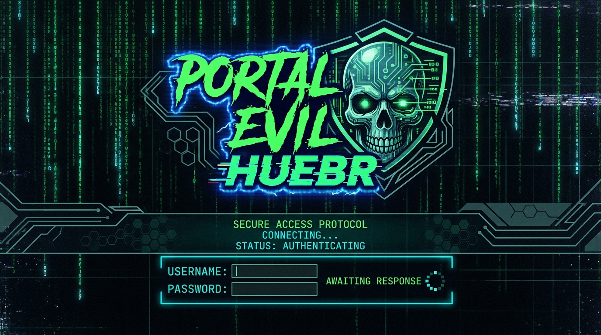

<div align="center">



# ⚡ Portal Evil HUEBR

### Educational captive portal (“Evil Portal”) for the **M5StickC Plus**

_Built for Wi-Fi security awareness, live demos, and research._

<p>
  <a href="LICENSE"></a>
  
  
  
  
</p>

**Author:** [@raphntc](https://github.com/raphntc/) &nbsp;·&nbsp; **License:** [MIT](LICENSE)

</div>

---

> [!CAUTION]
> **For educational and authorized security-testing use only.** Do not use it against networks, devices, or people without **explicit permission**. Capturing credentials from users who have not consented is illegal in most jurisdictions. You are solely responsible for how you use this software and assume all associated risks.

> [!NOTE]
> This project is **not affiliated with, endorsed by, or supported by Facebook/Meta** or any other brand referenced in the demo page. Those names and layouts are used only to illustrate how phishing portals impersonate well-known services.

<details>
<summary>🇧🇷 <b>Aviso em Português</b></summary>

<br>

Este código é fornecido **apenas para fins educacionais e testes de segurança autorizados**. Não o utilize contra redes, dispositivos ou pessoas sem **permissão explícita**. Capturar credenciais de usuários que não consentiram é ilegal na maioria dos países. Você é o único responsável pelo uso deste software e assume todos os riscos envolvidos.

Este projeto **não é afiliado, endossado ou suportado pelo Facebook/Meta** nem por qualquer outra marca citada na página de demonstração. Esses nomes e layouts são usados somente para ilustrar como portais de phishing imitam serviços conhecidos.

</details>

---

## 📑 Table of Contents

- [📖 About](#about)
- [🆕 What's New](#whats-new)
- [🔐 Admin Access — default login](#login)
- [📸 Preview](#preview)
- [✨ Features](#features)
- [🛠️ Hardware](#hardware)
- [📦 Requirements](#requirements)
- [🚀 Installation / Flashing](#install)
- [▶️ Usage](#usage)
- [⚙️ Configuration](#config)
- [🙌 Credits](#credits)

---

## <a id="about"></a>📖 About

Wi-Fi honeypots are deceptive wireless networks that masquerade as legitimate hotspots. They lure users with the promise of free internet, then present a fake “sign-in” page to harvest data. This project recreates that scenario on cheap, pocket-sized hardware so students, educators, and security professionals can **see the technique in action** and learn to recognize and defend against it.

<details>
<summary>🇧🇷 <b>Sobre (Português)</b></summary>

<br>

Honeypots Wi-Fi são redes sem fio enganosas que se disfarçam de hotspots legítimos. Elas atraem usuários com a promessa de internet gratuita e então exibem uma página falsa de “login” para roubar dados. Este projeto recria esse cenário em um hardware barato e de bolso, para que estudantes, educadores e profissionais de segurança possam **ver a técnica em ação** e aprender a reconhecê-la e se defender dela.

</details>

---

## <a id="whats-new"></a>🆕 What's New

Highlights added in this build:

| | |
|---|---|
| 🔐 | **Login-protected dashboard** — `/admin` and every operator action now sit behind HTTP Basic Auth. **Default login `admin` / `huebr`** — [see below](#login). |
| 🧰 | **Web settings page** (`/settings`) — change SSID, auto-refresh, brightness, beep/LED and the admin login from the browser, no reflashing. |
| 💾 | **Persistent settings** — all configuration is saved to flash (NVS) and restored on boot. |
| ⬇️ | **Export captures** as **CSV** (`/export.csv`) or **JSON** (`/export.json`). |
| 📊 | **Richer dashboard** — six stat tiles, an AP info bar (SSID / gateway / channel / MAC / buffer) and a live search filter. |
| 🧠 | **Bounded capture storage** — a 50-entry ring buffer replaces the old unbounded string (fixes a memory-growth crash). |
| 🎛️ | **On-device menu** — boots into Tools / Configuration / Exit with icons, a live status panel, `Reset Captures` and `Flip Screen`. |
| 💀 | **Vector laughing-skull boot animation** (~5 s). |
| 🔋 | **Battery gauge** (cell icon + %) and the **admin URL** shown on the LCD. |

---

## <a id="login"></a>🔐 Admin Access — default login

> [!IMPORTANT]
> The operator dashboard (`/admin`) and all of its actions are protected by a login. The **default credentials** are:
>
> | | |
> |:--|:--|
> | **User** | `admin` |
> | **Password** | `huebr` |
>
> **Change them before any real use.** You can do it two ways:
> - On the device-served **`/settings`** page (no reflashing — saved to flash), or
> - By editing the `ADMIN_USER_DEF` / `ADMIN_PASS_DEF` defines at the top of the sketch.
>
> The login can also be **disabled** entirely from `/settings`. Victim-facing routes (`/`, `/post`) are never gated.

Open the dashboard while connected to the AP:

```
http://172.0.0.1/admin
```

…and enter the credentials when the browser prompts you.

<details>
<summary>🇧🇷 <b>Login padrão (Português)</b></summary>

<br>

O painel do operador (`/admin`) é protegido por login. As **credenciais padrão** são:

| | |
|:--|:--|
| **Usuário** | `admin` |
| **Senha** | `huebr` |

**Troque-as antes de qualquer uso real** — pela página **`/settings`** (servida pelo próprio aparelho, sem regravar; fica salva na flash) ou alterando os defines `ADMIN_USER_DEF` / `ADMIN_PASS_DEF` no início do código. O login também pode ser **desativado** em `/settings`. As rotas da vítima (`/`, `/post`) nunca são bloqueadas. Acesse o painel em **`http://172.0.0.1/admin`**.

</details>

---

## <a id="preview"></a>📸 Preview

<div align="center">


<sub><i>Portal Evil HUEBR running on the M5StickC Plus</i></sub>

</div>

---

## <a id="features"></a>✨ Features

| | |
|---|---|
| 📶 | Creates an **open Wi-Fi access point** with a configurable SSID (default: `Wi-Fi Gratis`) |
| 🌐 | **Captive portal** via DNS spoofing — any requested domain is redirected to the portal page |
| 🔐 | Serves a customizable fake **sign-in page** and stores submitted credentials in a **bounded ring buffer** (max 50, oldest dropped — so RAM never overflows); HTML-escaped on capture |
| ⏳ | **Animated “validating access” page** after submission — pure CSS/JS (works offline): pulsing Wi-Fi icon, indeterminate progress bar, spinner and a live countdown |
| 💀 | **Laughing-skull boot animation** (~5 s) — a smooth vector skull with a dropping jaw, pulsing red eyes, a “HA HA HA!” burst and a progress bar |
| 🎛️ | **On-device menu** on boot (Tools / Configuration / Exit) with icons, a selection caret and a **live status panel** (portal state, captures, connected clients) — the portal no longer auto-starts; navigate with the two buttons and launch it on demand |
| 🖥️ | Live stats on the built-in LCD: SSID, the **admin URL** (`http://172.0.0.1/admin`), a **battery gauge** (cell icon + %), and the **victim/capture count** |
| 🔊 | **Beep + non-blocking LED blink** feedback on every submission (DNS/HTTP keep serving during the blink), both toggleable from the Configuration menu |
| 📋 | **Operator dashboard** at `/admin` — dark theme, six stat tiles (stored, lifetime, unique emails, clients online, uptime, free heap), an **AP info bar** (SSID / gateway / channel / MAC / buffer), a **client-side search filter**, configurable auto-refresh, and one-click reset |
| 🔑 | **Login-protected admin** — the dashboard and its actions sit behind HTTP Basic Auth (user/password configurable; can be turned off) |
| ⬇️ | **Export captures** as **CSV** (`/export.csv`) or **JSON** (`/export.json`) with proper download headers |
| 🧰 | **Web settings page** (`/settings`) — change SSID, auto-refresh interval, brightness, beep/LED, and the admin login live, with no reflashing |
| 💾 | **Persistent settings** — all configuration (SSID, login, toggles, brightness, rotation) is saved to flash (NVS) and restored on boot |
| 🧩 | **Single-file Arduino sketch** — easy to read, modify, and flash |

---

## <a id="hardware"></a>🛠️ Hardware

- **M5StickC Plus** (ESP32-PICO based)
- USB-C cable for flashing and power

## <a id="requirements"></a>📦 Requirements

- [Arduino IDE](https://www.arduino.cc/en/software) (or Arduino CLI / PlatformIO)
- **ESP32 board support** installed via Boards Manager
- Libraries:
  - `M5StickCPlus`
  - `WiFi`, `DNSServer`, `WebServer`, `Preferences` (all bundled with the ESP32 core)

---

## <a id="install"></a>🚀 Installation / Flashing

### 🔥 Option A — M5Burner <sub>(easiest, no compiling)</sub>

This project is also published in **[M5Burner](https://docs.m5stack.com/en/download)**, M5Stack’s official firmware tool. No Arduino IDE or compilation required.

1. Download and open **M5Burner**.
2. Search for **Portal Evil HUEBR** in the firmware list.
3. Connect your M5StickC Plus via USB-C, select the COM/serial port, and click **Burn**.

> **🇧🇷 PT-BR:** O projeto também está disponível no **M5Burner**, o aplicativo oficial da M5Stack. Basta procurar por **Portal Evil HUEBR**, conectar o dispositivo e clicar em **Burn** — sem precisar compilar nada.

### 🧰 Option B — Arduino IDE <sub>(build from source)</sub>

1. Install the **Arduino IDE** and add ESP32 board support
   (Boards Manager URL: `https://raw.githubusercontent.com/espressif/arduino-esp32/gh-pages/package_esp32_index.json`).
2. Open **Tools → Manage Libraries** and install **`M5StickCPlus`**.
3. Open [`portal-evil-huebr/portal-evil-huebr.ino`](portal-evil-huebr/portal-evil-huebr.ino).
4. Select the board **M5Stick-C** (or **ESP32 PICO-D4**) and the correct COM/serial port.
5. Click **Upload**.

### ⚙️ Option C — Build the `.bin` with a script <sub>(for M5Burner)</sub>

Generate the firmware `.bin` yourself — handy to flash a customized build in M5Burner. The only prerequisite is **[arduino-cli](https://arduino.github.io/arduino-cli/latest/installation/)** on your `PATH`; the scripts install the ESP32 core and the `M5StickCPlus` library automatically.

| Platform | Command |
| --- | --- |
| 🪟 **Windows (double-click)** | Double-click **`build.bat`** |
| 🪟 Windows (PowerShell) | `powershell -ExecutionPolicy Bypass -File scripts\build.ps1` |
| 🐧🍎 Linux / macOS / Git Bash | `./scripts/build.sh` |

The build writes two files to the **`firmware/`** folder:

| File | Flash offset | Use |
| --- | --- | --- |
| `portal-evil-huebr-m5stickcplus-merged.bin` | **`0x0`** | ✅ **Upload this one to M5Burner** (full image: bootloader + partitions + app) |
| `portal-evil-huebr-m5stickcplus-app.bin` | `0x10000` | App only — for tools that flash the app at its offset |

> **M5Burner:** add a custom firmware, pick the **`-merged.bin`**, and (if asked for an address) write it at **`0x0`**.

> **🇧🇷 PT-BR:** No Windows, é só dar **duplo-clique em `build.bat`**. Ele compila e gera o `.bin` na pasta `firmware/`. No M5Burner, envie o arquivo **`-merged.bin`** (grava em `0x0`).

---

## <a id="usage"></a>▶️ Usage

1. On power-on, the device plays the **laughing-skull splash** (~5 s) and then opens the **main menu** — it does **not** start the portal automatically.
2. Use the two buttons to navigate the menu:
   - **Side button (BtnB)** → move the highlight
   - **Front button (BtnA)** → select
3. Choose **Tools → Start Portal** to bring up the open Wi-Fi access point, DNS redirect, and web server, and switch to the live LCD dashboard.
4. When a device connects, the captive portal automatically opens the fake sign-in page.
5. On submission, the device beeps, blinks its LED, bumps the LCD capture count, and the connected device sees the animated **“validating access”** page.
6. Submissions are stored in RAM. Review them on the operator dashboard (while connected to the AP):

   ```
   http://172.0.0.1/admin
   ```

   You'll be asked to log in (default `admin` / `huebr`). From there you can filter, **export CSV/JSON**, open **`/settings`**, or clear the list.
7. Reset the stored list from the dashboard’s **Clear all** button, or directly at `http://172.0.0.1/clear`.
8. While the portal is running, **hold the side button (BtnB) for ~1 s** to stop it and return to the menu.

### 🎛️ On-device menu

Each row has an icon and a selection caret; the footer shows a position indicator (e.g. `2/4`). The **Main** menu doubles as a live status panel — a strip under the header shows **portal ON/OFF**, **captures**, and **connected clients**, refreshing every second.

| Menu | Option | Action |
| --- | --- | --- |
| **Main** | `Tools` / `Configuration` / `Exit` | Enter a submenu, or power off (`Exit` → confirm). Live status strip on top. |
| **Tools** | `Start Portal` | Start the AP + captive portal and show the dashboard |
| | `Device Info` | Show SSID, admin URL, portal status, and captures/clients |
| | `Reset Captures` | Clear all captured credentials from the device (with confirmation toast) |
| | `Back` | Return to the main menu |
| **Configuration** | `Beep: ON/OFF` | Toggle the capture/boot beep |
| | `LED blink: ON/OFF` | Toggle the LED blink on capture |
| | `Brightness: 1/2/3` | Cycle the screen brightness |
| | `Flip Screen` | Rotate the display 180° (for either hand) |
| | `Back` | Return to the main menu |

> [!NOTE]
> Configuration (toggles, brightness, rotation, SSID, login) is **saved to flash and restored on boot**. Only the **captured credentials** live in RAM and are lost on reboot — export them first if you need them.

### 🔗 Pages / endpoints

| Path | Audience | Description |
| --- | --- | --- |
| `/` | 🎣 Victim | Fake sign-in page (any unknown URL redirects here via the captive portal) |
| `/post` | 🎣 Victim | Receives the form, stores the entry, returns the animated “validating” page |
| `/admin` | 🛡️ Operator 🔑 | Dashboard: stat tiles, AP info, searchable capture table (auto-refresh configurable) |
| `/settings` | 🛡️ Operator 🔑 | Web config form (GET) / apply + persist (POST) |
| `/export.csv` | 🛡️ Operator 🔑 | Download all captures as CSV |
| `/export.json` | 🛡️ Operator 🔑 | Download all captures as JSON |
| `/clear` | 🛡️ Operator 🔑 | Clears all stored entries |

> [!NOTE]
> 🔑 endpoints are protected by HTTP Basic Auth when the login is enabled (default **on**). Default credentials are `admin` / `huebr` — change them in `/settings` or via the `ADMIN_USER_DEF` / `ADMIN_PASS_DEF` defines. Victim-facing routes (`/`, `/post`) are never gated.

---

## <a id="config"></a>⚙️ Configuration

All portal text and branding are set with `#define` values near the top of
[`portal-evil-huebr.ino`](portal-evil-huebr/portal-evil-huebr.ino):

| Define | Purpose | Default |
| --- | --- | --- |
| `SSID_NAME` | Name of the broadcast Wi-Fi network | `Wi-Fi Gratis` |
| `SUBTITLE` | Header subtitle on the post/admin pages | `E-CORP service.` |
| `POST_TITLE` | Title shown after a submission | `Validando Acesso...` |
| `POST_BODY` | Body text shown after a submission | _(Portuguese message)_ |
| `PASS_TITLE` | Title of the credentials page (`/admin`) | `Credentials` |
| `CLEAR_TITLE` | Title of the reset-confirmation page (`/clear`) | `Cleared` |
| `ADMIN_USER_DEF` | Default dashboard login user (first boot) | `admin` |
| `ADMIN_PASS_DEF` | Default dashboard login password (first boot) | `huebr` |
| `MAX_CAPTURES` | Ring-buffer size (max credentials kept in RAM) | `50` |

> [!TIP]
> The login page markup lives in the `index()` function — edit it to change the look or the service being impersonated for your demo.

### 📟 Runtime settings

Change these live — from the on-device **Configuration** menu or the web **`/settings`** page — with no reflashing. All are **persisted to flash (NVS)** and restored on boot:

| Setting | Where | Purpose | Default |
| --- | --- | --- | --- |
| `Beep` | Menu + Web | Beep on capture (and on the boot animation) | `ON` |
| `LED blink` | Menu + Web | Blink the LED on each capture | `ON` |
| `Brightness` | Menu + Web | Screen brightness level (1–3) | `3` |
| `Flip Screen` | Menu | Rotate the display 180° | `3` |
| `SSID` | Web | Broadcast Wi-Fi network name (restarts AP) | `Wi-Fi Gratis` |
| `Auto-refresh` | Web | Dashboard refresh seconds (0 = off) | `15` |
| `Login` | Web | Require HTTP Basic Auth on `/admin` | `ON` |
| `User` / `Password` | Web | Admin login credentials | `admin` / `huebr` |

### 🎨 Boot animation

The laughing skull is drawn with vector primitives (not a bitmap), so it stays crisp. Its colors and proportions are defined near the top of the sketch (`C_BONE*`, `C_SOCKET`, `C_EYE*`) and in `drawSkull()` — tweak those to restyle it.

---

## <a id="credits"></a>🙌 Credits

Based on work by:

- [n0xa](https://github.com/n0xa/) — original Evil Portal
- [Kuush01](https://github.com/Kuush01) — modifications
- [raphntc](https://github.com/raphntc) — M5StickC Plus port and further improvements

---

<div align="center">

Made with ⚡ for Wi-Fi security education · **[MIT](LICENSE)**

</div>
