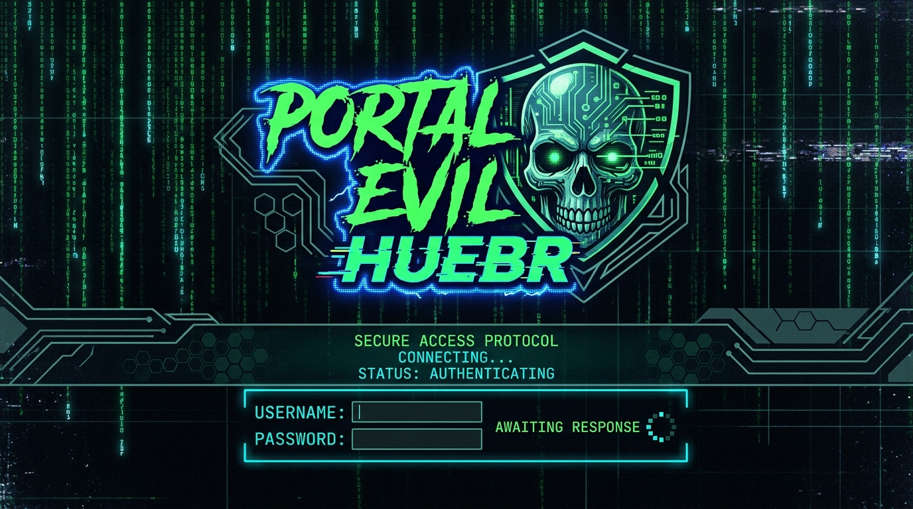

<div align="center">



# ⚡ Portal Evil HUEBR

### Educational captive portal (“Evil Portal”) for the **M5StickC Plus**

_Built for Wi-Fi security awareness, live demos, and research._

<p>
  <a href="LICENSE"></a>
  
  
  
  
</p>

**Author:** [@raphntc](https://github.com/raphntc/) &nbsp;·&nbsp; **License:** [MIT](LICENSE)

</div>

---

> [!CAUTION]
> **For educational and authorized security-testing use only.** Do not use it against networks, devices, or people without **explicit permission**. Capturing credentials from users who have not consented is illegal in most jurisdictions. You are solely responsible for how you use this software and assume all associated risks.

> [!NOTE]
> This project is **not affiliated with, endorsed by, or supported by Facebook/Meta** or any other brand referenced in the demo page. Those names and layouts are used only to illustrate how phishing portals impersonate well-known services.

<details>
<summary>🇧🇷 <b>Aviso em Português</b></summary>

<br>

Este código é fornecido **apenas para fins educacionais e testes de segurança autorizados**. Não o utilize contra redes, dispositivos ou pessoas sem **permissão explícita**. Capturar credenciais de usuários que não consentiram é ilegal na maioria dos países. Você é o único responsável pelo uso deste software e assume todos os riscos envolvidos.

Este projeto **não é afiliado, endossado ou suportado pelo Facebook/Meta** nem por qualquer outra marca citada na página de demonstração. Esses nomes e layouts são usados somente para ilustrar como portais de phishing imitam serviços conhecidos.

</details>

---

## 📖 About

Wi-Fi honeypots are deceptive wireless networks that masquerade as legitimate hotspots. They lure users with the promise of free internet, then present a fake “sign-in” page to harvest data. This project recreates that scenario on cheap, pocket-sized hardware so students, educators, and security professionals can **see the technique in action** and learn to recognize and defend against it.

<details>
<summary>🇧🇷 <b>Sobre (Português)</b></summary>

<br>

Honeypots Wi-Fi são redes sem fio enganosas que se disfarçam de hotspots legítimos. Elas atraem usuários com a promessa de internet gratuita e então exibem uma página falsa de “login” para roubar dados. Este projeto recria esse cenário em um hardware barato e de bolso, para que estudantes, educadores e profissionais de segurança possam **ver a técnica em ação** e aprender a reconhecê-la e se defender dela.

</details>

---

## 📸 Preview

<div align="center">


<sub><i>Portal Evil HUEBR running on the M5StickC Plus</i></sub>

</div>

---

## ✨ Features

| | |
|---|---|
| 📶 | Creates an **open Wi-Fi access point** with a configurable SSID (default: `Wi-Fi Gratis`) |
| 🌐 | **Captive portal** via DNS spoofing — any requested domain is redirected to the portal page |
| 🔐 | Serves a customizable fake **sign-in page** and stores submitted credentials in memory (HTML-escaped on capture) |
| ⏳ | **Animated “validating access” page** after submission — pure CSS/JS (works offline): pulsing Wi-Fi icon, indeterminate progress bar, spinner and a live countdown |
| 🖥️ | Live stats on the built-in LCD: SSID, gateway IP, and **victim/capture count** |
| 🔊 | **Beep + non-blocking LED blink** feedback on every submission (DNS/HTTP keep serving during the blink) |
| 📋 | **Operator dashboard** at `/creds` — dark theme, stat tiles, capture table (newest first, with capture time), auto-refresh, and one-click reset |
| 🧩 | **Single-file Arduino sketch** — easy to read, modify, and flash |

---

## 🛠️ Hardware

- **M5StickC Plus** (ESP32-PICO based)
- USB-C cable for flashing and power

## 📦 Requirements

- [Arduino IDE](https://www.arduino.cc/en/software) (or Arduino CLI / PlatformIO)
- **ESP32 board support** installed via Boards Manager
- Libraries:
  - `M5StickCPlus`
  - `WiFi`, `DNSServer`, `WebServer` (bundled with the ESP32 core)

---

## 🚀 Installation / Flashing

### 🔥 Option A — M5Burner <sub>(easiest, no compiling)</sub>

This project is also published in **[M5Burner](https://docs.m5stack.com/en/download)**, M5Stack’s official firmware tool. No Arduino IDE or compilation required.

1. Download and open **M5Burner**.
2. Search for **Portal Evil HUEBR** in the firmware list.
3. Connect your M5StickC Plus via USB-C, select the COM/serial port, and click **Burn**.

> **🇧🇷 PT-BR:** O projeto também está disponível no **M5Burner**, o aplicativo oficial da M5Stack. Basta procurar por **Portal Evil HUEBR**, conectar o dispositivo e clicar em **Burn** — sem precisar compilar nada.

### 🧰 Option B — Arduino IDE <sub>(build from source)</sub>

1. Install the **Arduino IDE** and add ESP32 board support
   (Boards Manager URL: `https://raw.githubusercontent.com/espressif/arduino-esp32/gh-pages/package_esp32_index.json`).
2. Open **Tools → Manage Libraries** and install **`M5StickCPlus`**.
3. Open [`portal-evil-huebr/portal-evil-huebr.ino`](portal-evil-huebr/portal-evil-huebr.ino).
4. Select the board **M5Stick-C** (or **ESP32 PICO-D4**) and the correct COM/serial port.
5. Click **Upload**.

---

## ▶️ Usage

1. After flashing, the device broadcasts the configured open Wi-Fi network.
2. When a device connects, the captive portal automatically opens the fake sign-in page.
3. On submission, the device beeps, blinks its LED, bumps the LCD capture count, and the connected device sees the animated **“validating access”** page.
4. Submissions are stored in RAM. Review them on the operator dashboard (while connected to the AP):

   ```
   http://172.0.0.1/creds
   ```

5. Reset the stored list from the dashboard’s **Clear all** button, or directly at `http://172.0.0.1/clear`.

> [!IMPORTANT]
> Captured data lives **only in RAM** and is lost on reboot.

### 🔗 Pages / endpoints

| Path | Audience | Description |
| --- | --- | --- |
| `/` | 🎣 Victim | Fake sign-in page (any unknown URL redirects here via the captive portal) |
| `/post` | 🎣 Victim | Receives the form, stores the entry, returns the animated “validating” page |
| `/creds` | 🛡️ Operator | Dashboard: stat tiles + table of captures (auto-refreshes every 15 s) |
| `/clear` | 🛡️ Operator | Clears all stored entries and the stored-entries counter |

---

## ⚙️ Configuration

All portal text and branding are set with `#define` values near the top of
[`portal-evil-huebr.ino`](portal-evil-huebr/portal-evil-huebr.ino):

| Define | Purpose | Default |
| --- | --- | --- |
| `SSID_NAME` | Name of the broadcast Wi-Fi network | `Wi-Fi Gratis` |
| `SUBTITLE` | Header subtitle on the post/admin pages | `E-CORP service.` |
| `POST_TITLE` | Title shown after a submission | `Validando Acesso...` |
| `POST_BODY` | Body text shown after a submission | _(Portuguese message)_ |
| `PASS_TITLE` | Title of the credentials page (`/creds`) | `Credentials` |
| `CLEAR_TITLE` | Title of the reset-confirmation page (`/clear`) | `Cleared` |

> [!TIP]
> The login page markup lives in the `index()` function — edit it to change the look or the service being impersonated for your demo.

---

## 🙌 Credits

Based on work by:

- [n0xa](https://github.com/n0xa/) — original Evil Portal
- [Kuush01](https://github.com/Kuush01) — modifications
- [raphntc](https://github.com/raphntc) — M5StickC Plus port and further improvements

---

<div align="center">

Made with ⚡ for Wi-Fi security education · **[MIT](LICENSE)**

</div>
